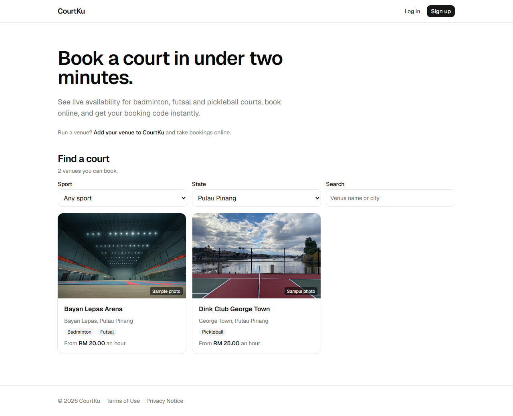
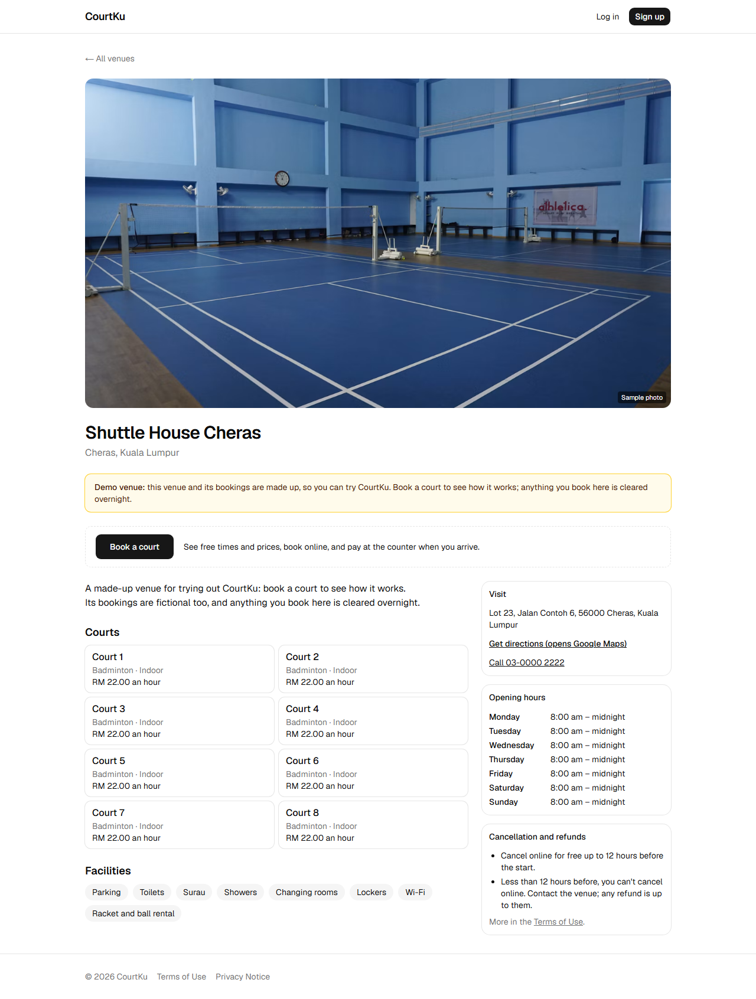
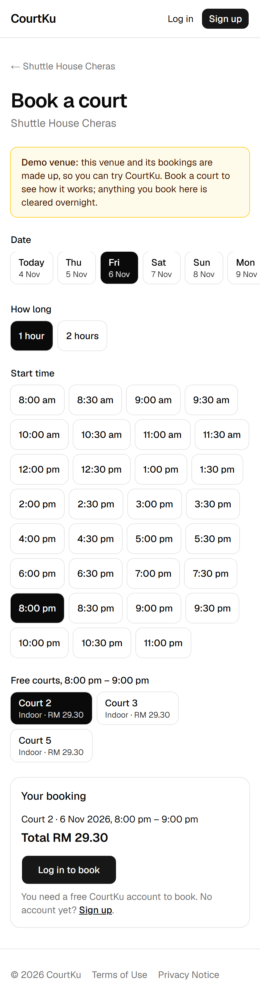
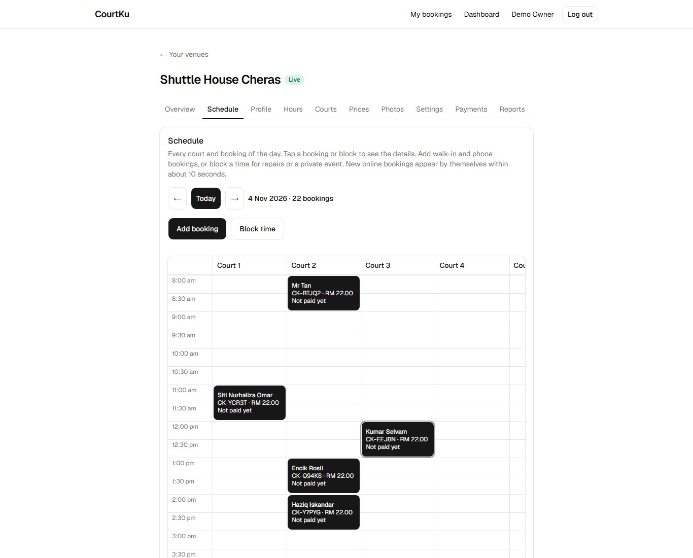
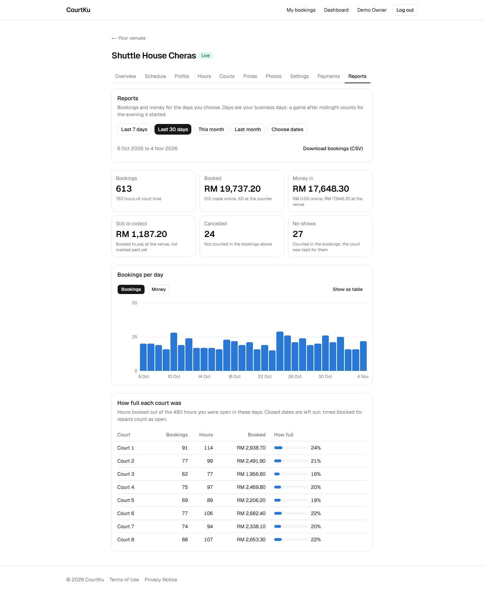
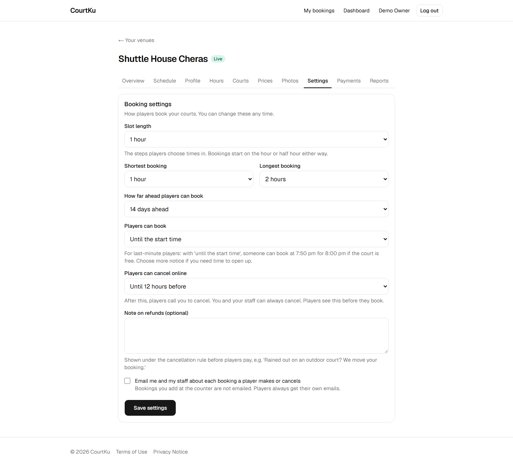

# CourtKu

Book a badminton, futsal or pickleball court in under two minutes. CourtKu is a multi-tenant SaaS: each venue gets its own booking page, players see live availability and pay online, and owners run their day from a dashboard.

> **Status:** M5 is complete. Venue owners sign up (with two-factor login), wait for approval, set up their venue, prices and booking rules, and connect their own Stripe account (Stripe Connect). Players find a venue on the home page, book, and pay online while the court is held for them, or pay at the counter; they get emails for each booking, a reminder before the game, and can cancel or delete their account. Staff run the day from a live schedule (walk-ins, blocks, check-in, paid at the counter); owners see reports with a CSV export and record refunds. The live site runs on a rolling demo world, with error and uptime alerts and nightly locked backups that are restored every night to prove they work. Next: M6, a real venue.

## Live demo

**https://courtku.vercel.app**

Log in with the demo account `player@example.com` / `CourtKu-Demo-2026`, or register your own.

The live site runs on **20 made-up demo venues** across Malaysia with about 10,000 bookings made through the real booking engine, kept fresh every night ([ADR-030](docs/adr/030-a-rolling-demo-world.md)). The home page lists every venue you can book, with filters for sport and state; a venue without its own photos shows a free sample photo from [Unsplash](https://unsplash.com/license) ([ADR-031](docs/adr/031-guest-venue-list-on-the-home-page.md)); Shuttle House Cheras also takes the test card below. What you book at a demo venue is cleared overnight.

Online payments run in **Stripe test mode: no real money is charged.** Pay with the test card `4242 4242 4242 4242`, any future expiry date and any CVC (`4000 0000 0000 0002` is always declined).

The API runs on a free plan that sleeps when nobody uses it, so the first request after a quiet period can take up to a minute.

**API documentation:** https://courtku-api.onrender.com/docs, every endpoint with its fields and examples, plus a [Postman collection](https://courtku-api.onrender.com/docs.postman) and an [OpenAPI file](https://courtku-api.onrender.com/docs.openapi) ([ADR-035](docs/adr/035-api-docs-served-at-docs.md)).

## Screenshots

Taken on a local copy with the demo data. The owner and staff side needs an owner account with two-factor login, so it isn't open on the live demo.

| Find a court (home page) | A venue's page |
| --- | --- |
|  |  |

| Booking on a phone | Staff: the day schedule |
| --- | --- |
|  |  |

| Owner: reports | Owner: booking settings |
| --- | --- |
|  |  |

## Tech stack

| Part | Technology |
| --- | --- |
| API | Laravel 13 (PHP 8.4), Sanctum + Fortify for auth, Pest for tests, Larastan + Pint for code quality |
| Web | Next.js 16 (TypeScript, App Router), Tailwind CSS, shadcn/ui, TanStack Query, React Hook Form + Zod, Vitest |
| Data | MySQL 8.4, Valkey (Redis-compatible) for cache and queues |
| CI | GitHub Actions on every pull request: lint, static analysis, tests, build, the production Docker image, and Playwright browser tests of the 4 key flows |
| Hosting | Vercel (web), Render (API, Docker), Aiven (MySQL), Brevo (email), Stripe test mode (payments), Cloudinary (photos) |
| Watching | Sentry (error alerts), UptimeRobot (uptime), nightly locked backups in a private repository, restored every night |

## How it fits together

```
Browser ──► Next.js web app (localhost:3000) ──► Laravel API (localhost:8000) ──► MySQL / Redis
             pages + forwards /api, /auth,         business rules, auth,
             /sanctum to the API                   bookings, payments
```

The browser only ever talks to the web app. The web app forwards API calls to Laravel, so the login cookie is a normal first-party cookie and there is no CORS setup ([ADR-004](docs/adr/004-sanctum-cookies-one-origin.md)).

## Repository layout

```
apps/api/     Laravel API
apps/web/     Next.js web app (browser tests in apps/web/e2e)
docs/adr/     Architecture decision records: why things are built this way
docs/         Deployment, security checklist, backups, README screenshots
docker/       Config for the local Docker services
docker-compose.yml   MySQL, Redis and Mailpit for local development
.github/workflows/   CI
```

## Run it locally (Windows)

You need: **PHP 8.4** (Laravel Herd), **Composer**, **Node.js 24**, **Git** and **Docker Desktop**. See [ADR-011](docs/adr/011-windows-native-local-dev.md) for why the apps run directly on Windows and only the databases run in Docker.

1. Start the databases and the email catcher:

   ```bash
   docker compose up -d
   ```

2. Set up and start the API (in a terminal, from `apps/api`):

   ```bash
   composer install
   cp .env.example .env
   php artisan key:generate
   php artisan migrate --seed
   php artisan serve
   ```

3. Start the web app (in a second terminal, from `apps/web`):

   ```bash
   npm install
   npm run dev
   ```

4. Open http://localhost:3000. Emails (verification, password reset) appear in Mailpit at http://localhost:8025.

**Local demo data** (created by `--seed`): the account `player@example.com` / `CourtKu-Demo-2026`, and a fictional approved venue at http://localhost:3000/v/arena-demo. For the full demo world as on the live site, set `DEMO_WORLD=true` in `apps/api/.env` and run `php artisan courtku:demo --until-done` (about 10 minutes); `schedule:work` then keeps it fresh.

**Photo uploads** need a free Cloudinary account; see the `CLOUDINARY_*` lines in `apps/api/.env.example` ([ADR-018](docs/adr/018-photos-on-cloudinary.md)).

**Online payments** need a free Stripe account in test mode with **Connect** turned on; put its secret key (`sk_test_...`) in `STRIPE_SECRET_KEY` ([ADR-023](docs/adr/023-stripe-test-mode-instead-of-billplz.md), [ADR-024](docs/adr/024-venues-connect-through-stripe-connect.md)). Stripe can't reach your laptop, so locally a payment is confirmed when the player comes back from Stripe's page. Run `php artisan schedule:work` for the every-minute jobs (hold expiry, payment checks, and sending the queued booking emails to Mailpit, [ADR-027](docs/adr/027-emails-queued-and-sent-by-the-tick.md)). Everything else works without these.

## Tests and checks

| What | Command | Where |
| --- | --- | --- |
| API tests | `vendor/bin/pest` | `apps/api` |
| API static analysis | `vendor/bin/phpstan analyse` | `apps/api` |
| API code style (fix) | `vendor/bin/pint` | `apps/api` |
| Web tests | `npm test` | `apps/web` |
| Web lint and types | `npm run lint` and `npm run typecheck` | `apps/web` |
| Browser tests (4 key flows, laptop and phone size) | `npm run e2e` | `apps/web` |
| API docs (write them again after changing an endpoint) | `composer docs` | `apps/api` |

The same checks run in GitHub Actions on every pull request.

The browser tests ([ADR-034](docs/adr/034-browser-tests-on-every-pull-request.md)) start their own API on port 8100, with its own `courtku_e2e` database and a pretend Stripe, and a production build of the web app on port 3100, so your local data is never touched. They need Docker's MySQL and Mailpit running (`docker compose up -d`) and Playwright's Chromium once (`npx playwright install chromium`). On Windows, point them at Herd's PHP first: `$env:E2E_PHP = "C:\Users\<you>\.config\herd\bin\php84\php.exe"`. An older Docker volume needs the `courtku_e2e` database added once (see `docker/mysql/init.sql`).

## Deployment

How the live demo is hosted and every production setting: [docs/deploy.md](docs/deploy.md).

## Decisions

Every important design decision has a short write-up in [docs/adr](docs/adr/README.md). The security checklist is in [docs/security.md](docs/security.md).
